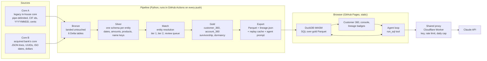

# Bank Core 360

Two mismatched banking cores, one governed customer-360 lakehouse, queryable in plain English with lineage on every answer. Static site, runs free on GitHub Pages. All data is synthetic.

**Live demo:** https://calvintirrell.github.io/bank-core360/


## Who this is for

A community bank or credit union that has just acquired another institution, or is mid-way through a core conversion, now runs two core banking systems that disagree about who its customers are. Customer IDs differ. Dates are `YYYYMMDD` in one system and ISO in the other. One core calls it `DDA`, the other calls it `checking`. Balances are in cents on one side and dollars on the other.

The people who feel this first:

- **Operations and deposit leaders** who want one list of customers and cannot get it without a ticket to IT and a week of reconciliation.
- **Data and BI analysts** who rebuild the same joins in spreadsheets and cannot defend a number when the examiner asks where it came from.
- **Compliance and audit** who need to know, for every figure in a report, which system it came from and what was done to it.

This demo is the first release I would ship for them, built end to end so the trade-offs are real rather than described.

## Three problems it solves

1. **One customer, two records.** Entity resolution across both cores with a deterministic tier, a fuzzy tier that scores each candidate pair, and a review queue for the pairs a human should look at. No silent overwrites. The matcher grades itself against ground truth: precision 1.0, recall 0.88, zero false merges on the designed same-name traps.
2. **Numbers nobody can defend.** Every column in the gold layer maps back to its source core, source field, and the transform rule that produced it. On the page, every result column carries a badge: A, B, or A+B. Click it and the lineage card shows the fields and rules.
3. **Questions that wait in the ticket queue.** Ask in plain English. A Claude agent writes the SQL, runs it in the browser, and explains the answer with caveats that cite the rules. The SQL is shown, not hidden, so an analyst can take it and keep going.

## What you can do on the page

- Browse the two raw feeds side by side, exactly as landed.
- Page and filter the customer-360 table. Click a customer to see their accounts across both cores.
- Read the entity-resolution scorecard: tiers, precision and recall, and the outcome for each designed difficulty.
- Run your own SQL in the console. DuckDB-WASM executes it in your browser against the gold Parquet. Nothing leaves the page.
- Ask a question. Six are cached and always work. Live questions run through a small shared proxy with a daily cap, or through your own Anthropic key by adding `?byok` to the URL.

## How it works



The pipeline is deterministic for its seed, so CI commits new outputs only when the code changed them. The Delta transaction logs are committed too, so anyone can open `lakehouse/gold/customer_360/_delta_log` and see the table format is real.

### The lakehouse

| Layer | What happens | Tables |
|---|---|---|
| raw | Core A: pipe-delimited `CUSTMAST` / `ACCTMAST` / `TXNHIST` with CIF numbers, `YYYYMMDD` dates, product codes, balances in cents. Core B: JSON lines with UUIDs, ISO dates, nested addresses. | 6 files |
| bronze | Landed untouched, plus ingest metadata | 6 Delta tables |
| silver | One schema per entity: parsed dates, signed amounts, canonical product taxonomy, 10-digit phones, name keys | customers, accounts, transactions |
| match | Entity resolution across cores: DOB blocking, SSN conflict reject, tier 1 deterministic, tier 2 fuzzy with a 0-1 confidence, review queue below threshold. Scored against ground truth. | customer_xref, match_review_queue |
| gold | `customer_360` (one row per resolved customer, survivorship rules, product flags, dormancy) and `account_360` | 2 Delta tables |
| export | Plain Parquet for the browser, `lineage.json` mapping every gold column to its source core, field and transform rule, the replay cache and the agent's prompt | 3 Parquet + 7 JSON/MD |

Synthetic scale: 2,000 people, 300 of them present in both cores across nine designed difficulty kinds (clean, nickname, typo, hyphenated name, missing SSN, changed last name, moved, and two that are deliberately undetectable), five same-name-and-birthday traps, about 4,900 accounts, 50,000 transactions. Every transform has a rule id (`S-xx`, `ER-xx`, `G-xx`) that the lineage file and the agent both cite.

### The agent

A Claude agent (Opus 5.5 by default) gets one tool, `run_sql`, which executes read-only DuckDB SQL in the browser. The system prompt and tool definition are generated by the pipeline from `lineage.json` so the schema the model sees is exactly the schema that ships. Three routes, in order:

1. Shared demo proxy: a small Cloudflare Worker holding the project's key, with an origin allowlist, a per-IP rate limit and a small daily cap. The page shows how many calls are left.
2. Your own key, direct from the browser to the Anthropic API, revealed with `?byok` in the URL. The key stays in the tab.
3. Replay: `lakehouse/export/replay.json` holds the six listed questions with SQL, real results and, when CI has a key, the model's own transcript. Used when the cap is reached or no route is available.

## Packaging sketch

This is a first cut from the product side, meant to be argued with. Most integration and data platforms meter compute, tasks, messages or active rows. Banks do not plan budgets in messages. They plan in connected systems and accounts, so the metering unit here is something a CFO can forecast a year out.

| Tier | Who | What's included | How it's priced |
|---|---|---|---|
| Sandbox | Evaluators, partners, hiring panels | Synthetic data, the full page, cached answers, no live AI | Free |
| Core | A bank with one or two cores | Platform fee, two core connectors, the governed customer-360 and account tables, SQL and dashboards, plain-English questions included | Annual platform fee plus a block of governed rows under management |
| Growth | Banks adding fintechs, CRM, card and payment feeds | Everything in Core, marketplace connectors, more sources, scheduled refreshes | Platform fee plus consumption above the included rows, connector SKUs for premium systems |
| Governed | Institutions preparing for examination or an acquisition | Everything in Growth, review-queue workflow, role-based masking, lineage and audit exports, retention controls | Platform fee uplift, priced per institution rather than per user |

Three deliberate choices:

- **AI questions are included, not metered.** Charging per question makes people stop asking. The cost is controlled underneath with model routing and spend caps, the way this demo's proxy does in miniature.
- **Core connectors are SKUs.** Each core family is real engineering and real maintenance, and the market already prices premium connectors separately. That is also where a sales conversation naturally starts.
- **Governance is the upsell, not the base.** Lineage and review queues are what examiners and acquirers ask for, and they are worth more to a bank in the month before an audit than in any other month.

What I would validate first: the included-row block sizes, whether per-institution pricing for the Governed tier holds up for multi-charter holding companies, and what customers pay today for their core vendor's own reporting add-ons, which is the real anchor.

## Roadmap: the next two releases

**Release 1, keep it current.** Incremental loads with change capture instead of full rebuilds, with Delta time travel exposed on the page so a user can ask "what did this customer look like last quarter." A review-queue workflow: approve or reject a proposed merge, and the decision feeds back into the next match run. Scheduled data-quality checks with the results shown next to the tables they describe.

**Release 2, open it up.** An Iceberg mirror of the gold layer behind a catalog so the bank's BI tool and warehouse read the same tables the page does. Role-based masking applied at query time, so the analyst sees SSN last-4 and the branch manager does not. An audit log of every question, the SQL it produced and who asked. Export to the bank's own reporting tool.

**Later.** More core connectors, streaming feeds for the transaction table, and write-back actions such as flagging a customer for outreach from a query result.

## What was harder than expected

- **Delta logs and deterministic CI.** The data is byte-identical run to run, but Delta transaction logs carry timestamps and random part-file names. The fix was a commit rule: the raw feeds and exports are the change signal, and the Delta tables are committed only alongside a real data change.
- **DuckDB-WASM cannot read Delta.** The browser engine has no Delta or Iceberg reader, so the pipeline exports plain Parquet as a serving layer. That turned out to be the realistic pattern anyway: the table format is the system of record, the serving layer is what consumers touch.
- **Fuzzy matching that actually decides something.** The first version's phone and postal-code signals were decorative, because the synthetic people had the same contact details in both cores. It took designing cases where the person had moved to make the boosts decisive, and recall dropping to 0.88 was the honest result, not a regression.
- **"Dormant customer" is not "dormant account."** The customer-level flag is true if any open checking account is dormant, so a customer can be flagged and still active elsewhere. The agent caught this on its own because the rule is in its prompt, which is the argument for putting lineage rules in front of the model rather than hoping it infers them.
- **Infrastructure that lies quietly.** The first rate-limiter configuration deployed as inert metadata and enforced nothing. It was only caught by firing requests at it. Every guard on the proxy is now verified by a test, not by reading the config.
- **Cost control on a public AI demo.** The daily cap counts API calls, and a question takes two or more. That is fine for a demo and exactly the kind of metering decision that would need a real answer in a product.

## Repo layout

```
data/generators/   synthetic Core A (legacy) and Core B (acquired bank) feeds, seeded
data/truth/        generator ground truth, used only to score entity resolution
pipeline/          bronze -> silver -> match -> gold (Delta Lake) -> export, lineage, agent prompt, replay
lakehouse/raw/     the two feeds exactly as a bank would hand them over
lakehouse/bronze|silver|gold/   Delta tables (open the _delta_log folders)
lakehouse/export/  gold Parquet, lineage.json, match_report.json, replay.json, agent_prompt.md
site/              Vite + React + TypeScript; DuckDB-WASM query layer, lineage badges, agent UI
proxy/             Cloudflare Worker that holds the shared demo key (rate-limited, daily cap)
tests/             pytest for the pipeline; vitest under site/src for the browser libraries
.github/workflows  pipeline -> commit outputs if changed -> build site -> deploy Pages
```

## Run locally

```
uv sync
uv run python -m pipeline
uv run pytest
cd site && pnpm install && pnpm dev
```

Python 3.12, Polars, PyArrow, delta-rs, DuckDB, rapidfuzz, Faker. Site: Vite, React, Tailwind, DuckDB-WASM, the Anthropic TypeScript SDK. The proxy deploys with wrangler; set `PROXY_URL` as a repository variable and `ANTHROPIC_API_KEY` as an optional secret for the replay transcripts.

## Data and privacy

Every person, account and transaction here is generated from a seed. There are no real customers, no real institutions, and no real identifiers. The two cores are labelled A and B on purpose.
