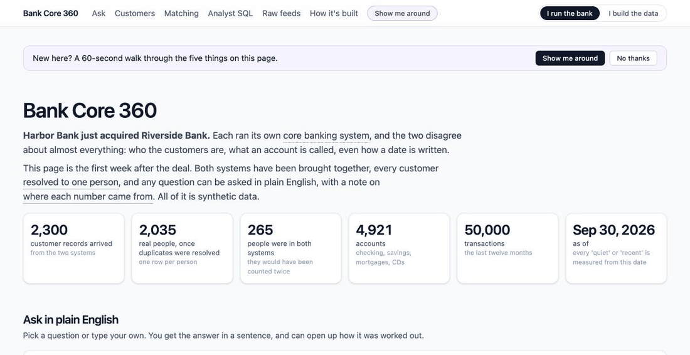
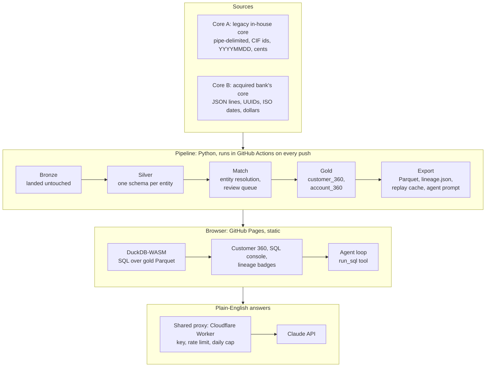

# Bank Core 360

Two mismatched banking cores, one governed customer-360 lakehouse, queryable in plain English with lineage on every answer. Static site, runs free on GitHub Pages. All data is synthetic.

**Live demo:** https://calvintirrell.github.io/bank-core360/



## If you are not technical, start here

Harbor Bank has just acquired Riverside Bank. Each ran its own core banking system, and the two disagree about almost everything: who the customers are, what an account is called, even how a date is written. The page is the first week after the deal, with both systems brought together and every customer resolved to one person.

You can ask a question in plain English and get the answer in a sentence, see every customer as one person rather than two records, and see which possible duplicates the matching held back for a human to check and why. Nothing to install and no SQL to read. Press **Show me around** in the header for a 60-second walk through the five things on the page, and hover any underlined term for a one-line definition in bank language.

The page has two views. **I run the bank** is the default and hides the plumbing. **I build the data** shows everything: the queries behind each answer, the raw files as received, the matching rules with their ids, and the architecture. Add `?mode=tech` or `?mode=bank` to the link to send someone straight to one view.

## Who this is for

A community bank or credit union that has just acquired another institution, or is mid-way through a core conversion, now runs two core banking systems that disagree about who its customers are. Customer IDs differ. Dates are `YYYYMMDD` in one system and ISO in the other. One core calls it `DDA`, the other calls it `checking`. Balances are in cents on one side and dollars on the other.

The people who feel this first:

- **Operations and deposit leaders** who want one list of customers and cannot get it without a ticket to IT and a week of reconciliation.
- **Data and BI analysts** who rebuild the same joins in spreadsheets and cannot defend a number when the examiner asks where it came from.
- **Compliance and audit** who need to know, for every figure in a report, which system it came from and what was done to it.

This demo is the first release I would ship for them, built end to end so the trade-offs are real rather than described.

## Three problems it solves

1. **One customer, two records.** Entity resolution across both cores with a deterministic tier, a fuzzy tier that scores each candidate pair, and a review queue for the pairs a human should look at. No silent overwrites. The matcher grades itself against ground truth: precision 1.0, recall 0.88 on the first load and 0.90 once reviewer decisions are applied, zero false merges on the designed same-name traps.
2. **Numbers nobody can defend.** Every column in the gold layer maps back to its source core, source field, and the transform rule that produced it. On the page, every result column carries a badge: A, B, or A+B. Click it and the lineage card shows the fields and rules.
3. **Questions that wait in the ticket queue.** Ask in plain English. A Claude agent writes the SQL, runs it in the browser, and explains the answer with caveats that cite the rules. The SQL is shown, not hidden, so an analyst can take it and keep going.

## Guide to the page

Everything below is on one page at the live link. Nothing to install, no account needed. The guide is written for the default "I run the bank" view; the technical view adds detail and is noted where it differs.

### Quick reference

| Feature | Where | What it does | How to use it |
|---|---|---|---|
| View switch | Top right | Chooses how much detail you see. "I run the bank" hides queries and raw data; "I build the data" shows everything. | Click either button. The choice is remembered. `?mode=bank` or `?mode=tech` on the link opens a view directly. |
| Show me around | Top right, and a banner on first visit | A 60-second tour in five stops: the problem, asking, the answer, one person not two records, who should check what. | Click it. Next, Back, Skip. A saved answer is shown at stop three at no cost. |
| As-of switch | Under the headline | Shows the whole page as of Sep 30, 2026 (the first load) or Oct 31, 2026 (one month later). Every table and check follows the date, and a live question is answered from that date's data. Saved answers are for the latest month. An answer already on screen stays when you switch, marked with the date it was answered for. | Click a date. "What changed" summarises the month; "Back to today" returns. `?asof=v0` on the link opens the earlier version. |
| Stat tiles | Under the headline | The headline numbers: records arrived, real people after duplicates were resolved, people in both banks, accounts, transactions, the as-of date. | Read them. In the technical view the labels are the technical names. |
| Ask in plain English | First section | Ask a question about customers, accounts or transactions in ordinary words. You get the answer in a sentence or two, often with a headline number or small chart, plus suggested next questions. | Click one of the seven ready questions, or type your own and press Enter. Typing a ready question in your own words still gets its saved answer. "Show how this was worked out" opens the query and the rows behind the answer. |
| Daily limit | Ask section | The shared demo allows 8 questions a day and 240 a month for everyone combined, and a question is only counted when it is actually answered. Saved answers for the seven ready questions always work. | When a limit is reached a red note says which one and when it resets; the ready questions still answer from the cache. With your own Anthropic key (`?byok` on the link) there is no limit. |
| Settings (gear) | Ask section, bank view | Model choice, "saved answers only", and how many questions are left today and this month, with the reset time. | Click the gear. Default model is Claude Opus 5.5. |
| The customers, one person each | Second section | Every real person as a card: which bank they came from, what they hold, deposits and loans, a red line if a checking account has gone quiet, and how confidently they were matched. | Use the filters (Everyone, In both banks, Matched by similarity, Mortgage and a quiet checking account, Harbor only, Riverside only) or search a name. Click a card for their accounts at each bank. Technical view: a table with the same filters and search; rows open with a click or the keyboard. |
| Are these the same person? | Third section | How the two banks' customer lists were matched: how many merged automatically, how many were held for a person, how many wrong merges against the answer key, with a worked example from the review queue and the rules in plain words. | Read it. Technical view: tiers, precision and recall, outcome by designed difficulty, and the scoring formula. |
| Can these numbers be trusted? | Fourth section | The ten checks the build ran, from "balances add up to the files the banks sent" to "'quiet' means what it says". The pipeline refuses to publish if any fails. | Read the green checks. Technical view: values, expected results and the SQL for each. |
| For analysts: run your own SQL | Collapsed section | A SQL console over the same four tables the answers use, run entirely in your browser. | Click Show. Pick an example or write a query, then Run or Cmd+Enter. Add `_v0` or `_latest` to a table name to pin a version, for example `customer_360_v0`. |
| Lineage badges | On every result column | Each column carries A, B or A+B for which bank's system it came from, or "derived" if the query computed it. | Click a badge for the sentence: which system, which field, what was done to it. Technical view adds the rule ids. |
| What the bank handed us | Collapsed section | The same facts written two different ways by the two banks, from real rows: a birthday, an id, a product code, a balance in cents versus dollars, a name, a signed amount. | Click Show. "See the raw files" opens the actual first rows of all six files. |
| How it's built | Collapsed section | The pipeline from raw feeds to the page, with the Iceberg mirror listed in the technical view. For engineers. | Click Show. |
| Why this matters | Under each section | The product view: the problem, the decision the section supports, one trade-off. | Click to expand. |
| Glossary | Underlined words | Short definitions in bank language for core banking system, matching, review queue, quiet account, where a number came from, as-of date. | Hover, tap or focus an underlined term. |

### Asking good questions

The agent can see four tables: one row per person, one row per account, every transaction for the year, and the review queue of unmerged possible duplicates. It knows the story names (Harbor Bank is the legacy core, Riverside Bank the acquired one), the as-of date, and that "quiet" or "dormant" means no transactions for 180 days. Questions that work well:

- Counts and totals by any grouping: by bank, state, product, month.
- Lists of people or accounts that meet conditions: "mortgage customers whose checking has gone quiet", "Riverside customers with a mortgage above $400,000".
- Comparisons between the two banks or between the two dates.
- Questions about the matching itself: how sure we are, which pairs to review first.

It cannot answer anything outside those tables, and it will say so. Every answer shows its query, so an analyst can take it further in the console.

### What happens behind a question

1. Your question goes to Claude with a description of the four tables generated from the lineage file.
2. Claude writes one SQL query and calls a `run_sql` tool. The query runs in DuckDB-WASM in your browser against the Parquet files on this site. A guard accepts only a single read-only statement over the page's own tables and refuses file paths, URLs and reading functions, so nothing leaves the page except the question and the result rows sent back to the model.
3. Claude reads the rows and writes the answer, with caveats that cite the rules it relied on, and suggests follow-up questions.
4. The page shows the answer first, and the query and rows under "Show how this was worked out".

A question normally costs two API calls. The seven ready questions also have saved answers, so they work even when the daily limit is reached.

## How it works



The pipeline is deterministic for its seed, so CI commits new outputs only when the code changed them. The Delta transaction logs and the Iceberg metadata are committed too, so anyone can open `lakehouse/gold/customer_360/_delta_log` on GitHub and see the table format is real. That costs a few megabytes of history each time the data genuinely changes, which is accepted on purpose: the repository is the exhibit.

### The lakehouse

| Layer | What happens | Tables |
|---|---|---|
| raw | Core A: pipe-delimited `CUSTMAST` / `ACCTMAST` / `TXNHIST` with CIF numbers, `YYYYMMDD` dates, product codes, balances in cents. Core B: JSON lines with UUIDs, ISO dates, nested addresses. | 6 files |
| bronze | Landed untouched, plus ingest metadata; batch 2 lands as Delta version 1 of each table | 6 Delta tables |
| silver | One schema per entity: parsed dates, signed amounts, canonical product taxonomy, digit-only phones, name keys | customers, accounts, transactions |
| match | Entity resolution across cores: DOB blocking, SSN conflict reject, tier 1 deterministic, tier 2 fuzzy with a 0-1 confidence, review queue below threshold, and reviewer decisions from `data/decisions/` applied as tier 3 once their date has passed. Scored against ground truth. | customer_xref, match_review_queue |
| gold | `customer_360` (one row per resolved customer, survivorship rules, product flags, dormancy), `account_360`, and `review_queue` (the unmerged candidate pairs, enriched for human triage); also mirrored as Apache Iceberg under `lakehouse/iceberg/` with a SQLite catalog (a snapshot per write: one append for the first batch, then a delete plus an append for the overwrite, so three per table; the catalog stores absolute paths, so it is rebuilt wherever the pipeline runs) | 3 Delta tables + 3 Iceberg tables |
| export | Plain Parquet for the browser, `lineage.json` mapping every gold column to its source core, field and transform rule, the replay cache, the quality checks, the change summary, the Iceberg summary and the agent's prompt and tool definition | 4 Parquet + 9 JSON + 1 MD |

Synthetic scale: 2,000 people, 300 of them present in both cores across nine designed difficulty kinds (clean, nickname, typo, hyphenated name, missing SSN, changed last name, moved, and two that are deliberately undetectable), five same-name-and-birthday traps, about 5,000 accounts, 50,000 transactions in the first load and a month more in the second. Every transform has a rule id (`S-xx`, `ER-xx`, `G-xx`) that the lineage file and the agent both cite.

### The agent

A Claude agent (Opus 5.5 by default) gets one tool, `run_sql`, which executes read-only DuckDB SQL in the browser. The system prompt and tool definition are generated by the pipeline from `lineage.json` so the schema the model sees is exactly the schema that ships. Three routes, in order:

1. Shared demo proxy: a small Cloudflare Worker holding the project's key, with an origin allowlist, a per-IP rate limit and a daily cap of 8 questions (240 a month), charged only when Anthropic actually answers. It accepts only this page's own request shape: the exact system prompt the site serves (checked by hash), the one `run_sql` tool, an allowed model and a capped token budget, so a spoofed origin cannot turn it into a general-purpose endpoint. The page shows how many questions are left.
2. Your own key, direct from the browser to the Anthropic API, revealed with `?byok` in the URL. The key stays in the tab.
3. Replay: `lakehouse/export/replay.json` holds the seven listed questions with SQL, real results and, when CI has a key, the model's own transcript. Used when the cap is reached or no route is available.

## Packaging sketch

This is a first cut from the product side, meant to be argued with. Most integration and data platforms meter compute, tasks, messages or active rows. Banks do not plan budgets in messages. They plan in connected systems and accounts, so the metering unit here is something a CFO can forecast a year out.

| Tier | Who | What's included | How it's priced |
|---|---|---|---|
| Sandbox | Evaluators, partners, hiring panels | Synthetic data, the full page, saved answers, no live AI | Free |
| Core | A bank with one or two cores | Platform fee, two core connectors, the governed customer-360 and account tables, SQL and dashboards, plain-English questions included | Annual platform fee plus a block of governed rows under management |
| Growth | Banks adding fintechs, CRM, card and payment feeds | Everything in Core, marketplace connectors, more sources, scheduled refreshes | Platform fee plus consumption above the included rows, connector SKUs for premium systems |
| Governed | Institutions preparing for examination or an acquisition | Everything in Growth, review-queue workflow, role-based masking, lineage and audit exports, retention controls | Platform fee uplift, priced per institution rather than per user |

Three deliberate choices:

- **AI questions are included, not metered.** Charging per question makes people stop asking. The cost is controlled underneath with model routing and spend caps, the way this demo's proxy does in miniature.
- **Core connectors are SKUs.** Each core family is real engineering and real maintenance, and the market already prices premium connectors separately. That is also where a sales conversation naturally starts.
- **Governance is the upsell, not the base.** Lineage and review queues are what examiners and acquirers ask for, and they are worth more to a bank in the month before an audit than in any other month.

What I would validate first: the included-row block sizes, whether per-institution pricing for the Governed tier holds up for multi-charter holding companies, and what customers pay today for their core vendor's own reporting add-ons, which is the real anchor.

## Roadmap: the next two releases

**Release 1, keep it current.** Delivered in part on this page: a second batch as a Delta version with an as-of switch, reviewer decisions that feed the next match run, and data-quality checks shown next to the tables. Still to do: incremental loads with change capture instead of full rebuilds, and scheduled checks that alert on drift.

**Release 2, open it up.** The Iceberg mirror of the gold layer is on this page already, behind a local catalog; a product would put it behind a REST catalog so the bank's BI tool and warehouse read the same tables the page does. Role-based masking applied at query time, so the analyst sees SSN last-4 and the branch manager does not. An audit log of every question, the SQL it produced and who asked. Export to the bank's own reporting tool.

**Later.** More core connectors, streaming feeds for the transaction table, and write-back actions such as flagging a customer for outreach from a query result.

## What was harder than expected

- **Delta logs and deterministic CI.** The data is byte-identical run to run, but Delta transaction logs carry timestamps and random part-file names. The fix was a commit rule: the raw feeds and exports are the change signal, and the Delta tables are committed only alongside a real data change.
- **DuckDB-WASM cannot read Delta.** The browser engine has no Delta or Iceberg reader, so the pipeline exports plain Parquet as a serving layer. That turned out to be the realistic pattern anyway: the table format is the system of record, the serving layer is what consumers touch.
- **Fuzzy matching that actually decides something.** The first version's phone and postal-code signals were decorative, because the synthetic people had the same contact details in both cores. It took designing cases where the person had moved to make the boosts decisive, and recall dropping to 0.88 was the honest result, not a regression.
- **"Dormant customer" is not "dormant account."** The customer-level flag is true if any open checking account is dormant, so a customer can be flagged and still active elsewhere. The agent caught this on its own because the rule is in its prompt, which is the argument for putting lineage rules in front of the model rather than hoping it infers them.
- **Infrastructure that lies quietly.** The first rate-limiter configuration deployed as inert metadata and enforced nothing. It was only caught by firing requests at it. Every guard in the Worker's code is now covered by a unit test that runs in CI (origin, rate limit, kill switch, body size, model, tool shape, prompt hash, metering, passthrough, no key leakage); the rate-limit binding itself is still proven by firing requests at the deployed Worker, because a binding cannot be unit-tested.
- **Cost control on a public AI demo.** The first cap counted API calls, and a question takes two or more, so the counter confused people. Counting questions instead needed the page to tell the proxy which call of a question each request is, because the proxy's key-value store is only eventually consistent and could not reliably recognise a follow-up call on its own. A hard per-day call ceiling backstops it. Exactly the kind of metering decision that needs a real answer in a product.

## Repo layout

```
data/generators/   synthetic Core A (legacy) and Core B (acquired bank) feeds, seeded, two batches
data/truth/        generator ground truth, used only to score entity resolution
data/decisions/    reviewer decisions on the queue (confirm / reject, dated), applied by the matcher
pipeline/          bronze -> silver -> match -> gold (Delta Lake) -> export, lineage, quality, agent prompt, replay
lakehouse/raw/     the two feeds exactly as a bank would hand them over, one folder per as-of date
lakehouse/bronze|silver|gold/   Delta tables, one version per batch (open the _delta_log folders)
lakehouse/iceberg/ Apache Iceberg mirror of the gold layer (SQLite catalog + warehouse)
lakehouse/export/  gold Parquet (latest and v0/), lineage, match report, quality, changes, replay, agent prompt
site/              Vite + React + TypeScript; DuckDB-WASM query layer, lineage badges, agent UI; vitest in src/
proxy/             Cloudflare Worker that holds the shared demo key; guard tests in proxy/test
tests/             pytest for the pipeline (runs the pipeline into a temp folder, never touches lakehouse/)
.github/workflows  build.yml: pipeline -> commit outputs if changed -> proxy tests -> site tests + build -> deploy Pages
                   ci.yml: secret-free checks on pull requests and on demand
```

## Run locally

```
uv sync
uv run python -m pipeline          # rebuilds lakehouse/ in place (deterministic; ~3 s)
uv run pytest                      # runs the pipeline into a temp folder first; lakehouse/ is untouched
cd site && pnpm install && pnpm dev            # http://localhost:5173/bank-core360/
cd site && pnpm typecheck && pnpm test && pnpm build
cd proxy && pnpm install && pnpm typecheck && pnpm test
```

Set `BANK_CORE_DATA_ROOT=/some/folder` to point the pipeline's outputs anywhere else. Without `VITE_PROXY_URL` the site has no live route and shows only the saved answers. To run the Worker locally: `cd proxy && pnpm dev` with an `.dev.vars` file holding `ANTHROPIC_API_KEY=...` (gitignored); it validates prompts against the live site's `data/` folder (`PROMPT_SOURCE` in `wrangler.toml`).

Python 3.12, Polars, PyArrow, delta-rs, pyiceberg, DuckDB, rapidfuzz, Faker. Site: Vite, React, Tailwind, DuckDB-WASM, the Anthropic TypeScript SDK. The proxy deploys with wrangler; set `PROXY_URL` as a repository variable and `ANTHROPIC_API_KEY` as a secret so CI can generate the replay transcripts. Pull requests run the secret-free checks in `ci.yml`.

## Data and privacy

Every person, account and transaction here is generated from a seed. There are no real customers, no real institutions, and no real identifiers. The two cores are labelled A and B on purpose.
